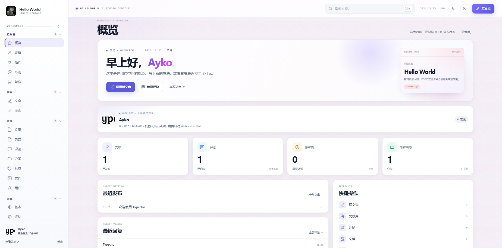
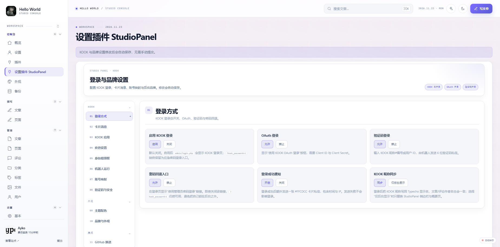
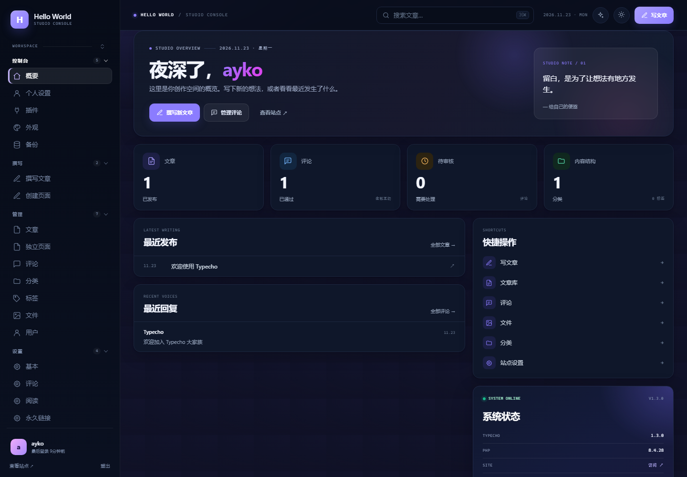
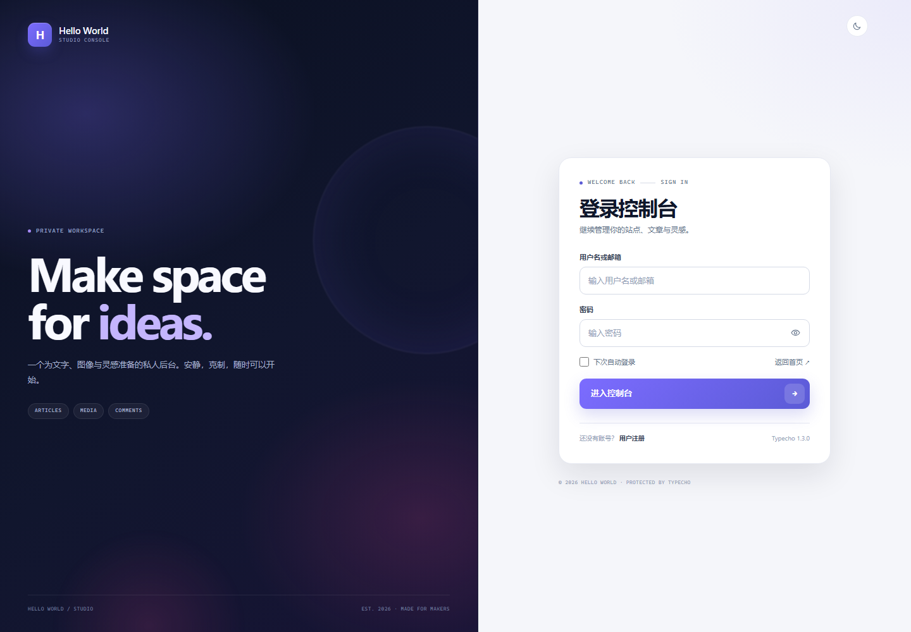
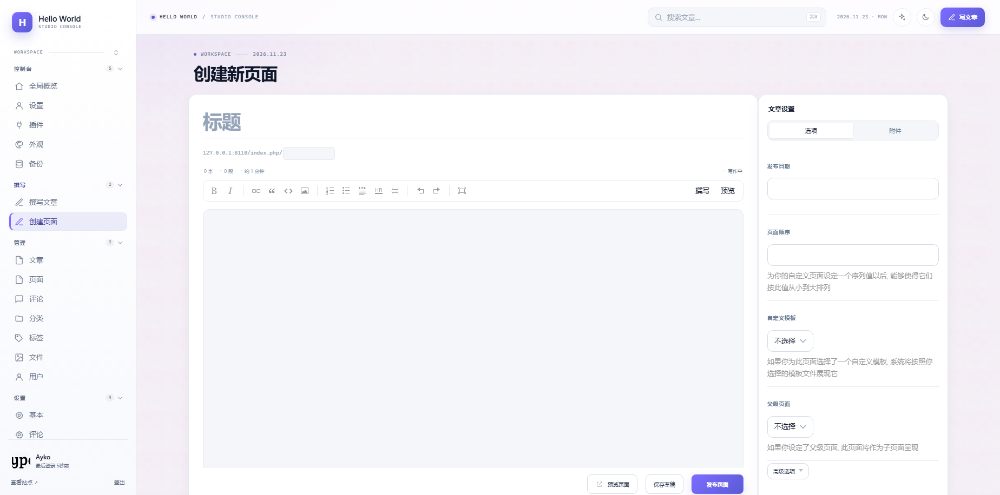

# MoePanel

> 面向 Typecho 的 KOOK 一体化控制台。  
> **1.0.0 正式发布版**

[](https://github.com/aayorishy/Typecho-MoePanel/releases)
[](https://typecho.org)
[](https://www.php.net)

MoePanel 在不修改 Typecho 核心文件的前提下，为后台提供一套统一的 Mac 风格控制台，并把 KOOK 登录、机器人、身份组、欢迎消息和 DeepSeek 角色扮演接入同一套设置界面。

## 截图

### 控制台概览



### 设置页



### 深色模式



### KOOK 登录



### 文章编辑器



## 功能

### 后台体验

- Mac 风格明暗主题
- 自定义主题色
- 可折叠侧边栏
- AJAX 无刷新导航
- 卡片、表格、表单统一设计
- 个人资料页重构
- 文章编辑器增强
- 概览页与机器状态页

### KOOK 登录

- KOOK OAuth2 登录
- 昵称#编号 / 用户 ID 登录
- 六位验证码私信登录
- 密码回退入口
- KOOK 昵称同步 Typecho
- 登录成功通知

### KOOK 机器人

- WebSocket 常驻 Bot
- 断线自动重连、指数退避与会话恢复
- 后台启用 / 停止 / 刷新
- 进程 PID 管理，避免重复启动
- 服务器信息与全部运行日志
- 在玩状态
- 邀请链接管理

### 身份组领取

- CardMessage 身份组面板
- 每个身份组独立「领取 / 移除」按钮
- 点击者身份识别
- 操作前检查是否已拥有
- 操作后验证身份组是否真正生效
- 失败原因私信反馈

### 欢迎消息

- 纯文字 KMarkdown 欢迎
- 支持 `{user}`、`{username}`、`{site}`、`{count}`
- `{count}` 来自 KOOK 服务器成员数量
- 不依赖 GD、FreeType 或图片生成
- 后台实时预览
- 测试欢迎消息

默认欢迎文字：

```text
欢迎 {user} 宝宝 ๑•́ㅅ•̀๑

( 欢迎小宝 )
( 玩的开心 )
```

### DeepSeek 角色扮演

- KOOK 中 @机器人 触发
- 普通 KMarkdown 文字回复，不使用卡片
- 每个服务器 / 用户独立上下文
- 支持重置上下文
- 可选频道自动回复
- 后台测试连接
- AI 入口、跳过原因、错误全部写入日志

### 更新与关于

- GitHub Releases 检测
- 更新包 SHA-256 校验
- 作者与项目信息
- 中文 README

## 1.0.0 更新内容

这是 MoePanel 的首个正式版本，主要更新如下：

### 后台界面

- 重构为 Mac 风格明暗双主题
- 新增可折叠侧边栏、AJAX 导航和统一卡片组件
- 重构概览页、个人资料页、文章编辑器
- 新增主题色、LOGO、登录页标题和副标题设置

### 设置结构

- 设置导航按「KOOK / 网站 / 关于」重新分组
- KOOK 分组：登录方式、应用设置、机器状态
- 网站分组：品牌外观
- 关于分组：更新检测、关于插件
- 移除无用的通用卡片编辑器

### KOOK 登录

- 支持 OAuth2 登录
- 支持昵称#编号 / 用户 ID + 验证码登录
- 支持密码回退
- 登录成功后同步 KOOK 昵称
- 登录成功卡片统一为 `#FFCDCC`

### KOOK 机器人

- WebSocket Bot 常驻运行
- 断线自动重连、指数退避、会话恢复和心跳超时检测
- 机器状态页直接启用 / 停止 / 刷新
- 使用 PID 文件避免重复启动
- 机器状态页汇总全部日志：
  - KOOK Bot
  - AI Chat
  - Events
  - Welcome
  - Role Claim
  - Post Push

### 欢迎消息

- 改为纯文字 KMarkdown，不再发送卡片或图片
- 支持 `{user}`、`{username}`、`{site}`、`{count}`
- `{count}` 使用 KOOK 服务器成员数量
- 欢迎设置只保留频道与欢迎文字
- 新增欢迎测试与 `moepanel-welcome.log`

### 身份组领取

- 使用 CardMessage 身份组面板
- 每个身份组独立「领取 / 移除」按钮
- 正确读取按钮点击者 `extra.body.user_id`
- `role_id` 以整数 JSON 提交
- 操作前检查是否已拥有
- 操作后重新查询成员身份组验证
- 失败原因私信反馈，写入 `moepanel-role-claim.log`

### 角色扮演

- KOOK 中 @机器人 触发 DeepSeek 回复
- 使用普通 KMarkdown 文字回复，不使用卡片
- 每个服务器 / 用户独立上下文
- 支持频道自动回复、测试连接、重置上下文
- 入口、跳过原因和错误全部写入日志

### 兼容与修复

- 修复从旧版本升级后设置页无法打开的问题
- 保留旧版 `welcomeTitle`、`welcomeText`、`welcomeImage` 选项的隐藏兼容字段
- 修复私有仓库更新检测
- 修复机器状态 PID 识别与重复启动提示

### 更新检测

- 支持 GitHub Releases 检测
- 支持私有仓库 GitHub API Token
- 更新包 SHA-256 校验
- 自动更新前检查 ZipArchive 与目录权限

## 环境要求

- Typecho 1.3+
- PHP 8.1+
- PHP cURL
- PHP mbstring
- PHP ZipArchive（自动更新）
- 可写的插件目录（自动更新）
- KOOK 机器人 Token 与服务器

欢迎消息为纯文字，**不需要 GD / FreeType**。

## 安装

1. 备份现有 `usr/plugins/MoePanel`。
2. 将插件放入：

   ```text
   usr/plugins/MoePanel
   ```

3. 在 Typecho 插件页启用 **MoePanel**。
4. 进入：

   ```text
   KOOK → 应用设置
   ```

   填写 KOOK Client ID、Client Secret、机器人 Token、服务器 ID。
5. 启动 Bot：

   ```bash
   php usr/plugins/MoePanel/kook-bot.php
   ```

   也可以直接在后台「机器状态」点击「启用」。

## 宝塔自动保活

WebSocket 断线会自动重连；如果 Bot 进程本身退出，可以用宝塔守护它，无需每天手动重启。

### 方案 A：宝塔 Supervisor 管理器

安装宝塔「Supervisor 管理器」后添加进程：

```text
名称：moepanel-bot
运行目录：/www/wwwroot/ayko-blog
启动命令：/www/server/php/82/bin/php usr/plugins/MoePanel/kook-bot.php
进程数：1
自动启动：开启
自动重启：开启
```

PHP 路径按宝塔实际版本修改。

### 方案 B：宝塔计划任务

添加 Shell 任务，每分钟执行：

```bash
/bin/bash /www/wwwroot/ayko-blog/usr/plugins/MoePanel/bin/watchdog.sh
```

脚本会：

- 检查 `/tmp/moepanel-kook-bot/bot.pid`
- 检查 `/tmp/moepanel-kook-bot/heartbeat`
- 进程不存在时自动启动
- 心跳超过 90 秒时重启进程
- 避免重复启动

日志：

```text
/tmp/moepanel-kook-bot/watchdog.log
```

如果服务器上还有旧 `StudioPanel` Bot，请先停止一次，避免两个 Bot 争抢同一个 Token。

## 升级

1. 备份插件目录和数据库。
2. 覆盖插件文件。
3. 重新进入插件页面。
4. 重启 Bot：

   ```bash
   pkill -f 'kook-bot.php'
   php usr/plugins/MoePanel/kook-bot.php
   ```

5. 在「机器状态」刷新，确认只有一份新进程。

## 常用设置

| 设置 | 说明 |
|---|---|
| 登录方式 | KOOK 登录总开关、OAuth、验证码、密码回退 |
| 应用设置 | 凭据、账号映射、卡片消息、欢迎、身份组、GitHub、角色扮演 |
| 机器状态 | Bot 启动 / 停止 / 刷新、服务器信息、全部日志 |
| 品牌外观 | LOGO、登录页标题与副标题 |
| 更新检测 | GitHub Releases 检查与更新 |
| 关于插件 | 作者、仓库、版本与更新安全说明 |

## 机器状态日志

机器状态页汇总以下日志：

```text
KOOK BOT     /tmp/moepanel-kook-bot/bot.log
AI CHAT      /tmp/moepanel-ai-chat.log
EVENTS       /tmp/moepanel-events.log
WELCOME      /tmp/moepanel-welcome.log
ROLE CLAIM   /tmp/moepanel-role-claim.log
POST PUSH    /tmp/moepanel-kook-bot/post-push.log
```

## 目录结构

```text
MoePanel/
├── Plugin.php
├── Panel.php
├── Updater.php
├── kook-bot.php
├── github-webhook.php
├── Kook/
│   ├── Auth.php
│   ├── Controller.php
│   ├── Settings.php
│   ├── KookClient.php
│   ├── BotDaemon.php
│   ├── BotRunner.php
│   ├── CardMessage.php
│   ├── RoleClaim.php
│   ├── Welcome.php
│   ├── AiChatService.php
│   ├── AiConversationStore.php
│   ├── DeepSeekClient.php
│   └── ...
├── assets/
├── templates/
└── docs/images/
```

## 常见问题

### Bot 显示未运行，但实际在线

检查是否还有旧进程：

```bash
ps -ef | grep -E 'kook-bot|StudioPanel|MoePanel' | grep -v grep
```

### 欢迎设置不生效

确认新 Bot 进程使用的是：

```text
usr/plugins/MoePanel/kook-bot.php
```

并查看：

```bash
tail -n 20 /tmp/moepanel-welcome.log
```

### 身份组没有授予

机器人需要：

- 「管理角色」权限
- 身份组排序高于目标身份组
- 能读取服务器成员列表

查看：

```bash
tail -n 20 /tmp/moepanel-role-claim.log
```

## 链接

- 仓库：<https://github.com/aayorishy/Typecho-MoePanel>
- Releases：<https://github.com/aayorishy/Typecho-MoePanel/releases>
- Issues：<https://github.com/aayorishy/Typecho-MoePanel/issues>
- 作者：<https://github.com/aayorishy>

## License

MIT
