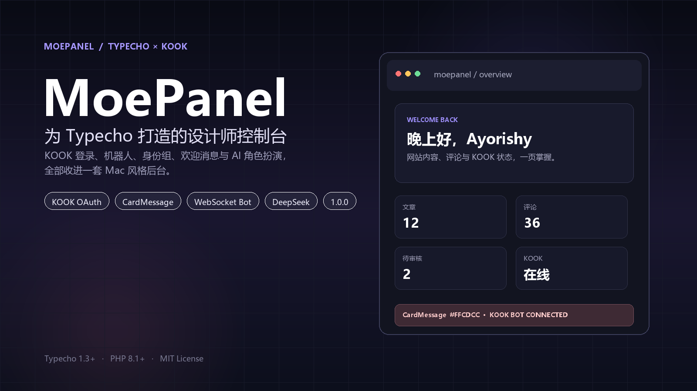
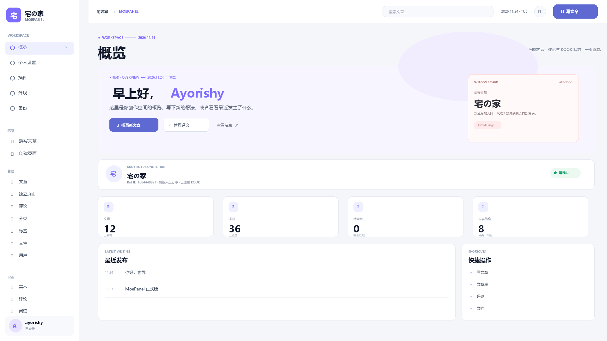
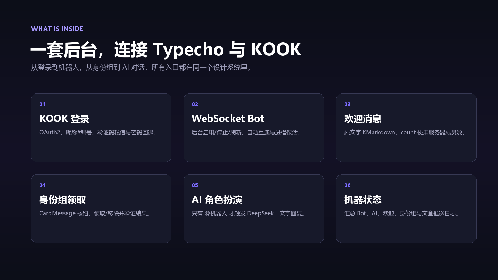
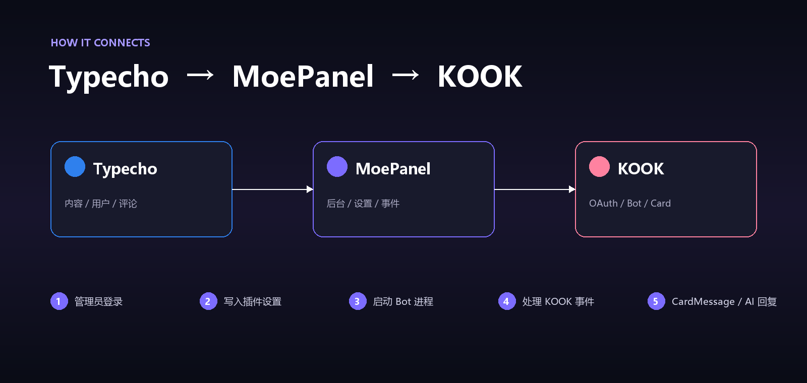
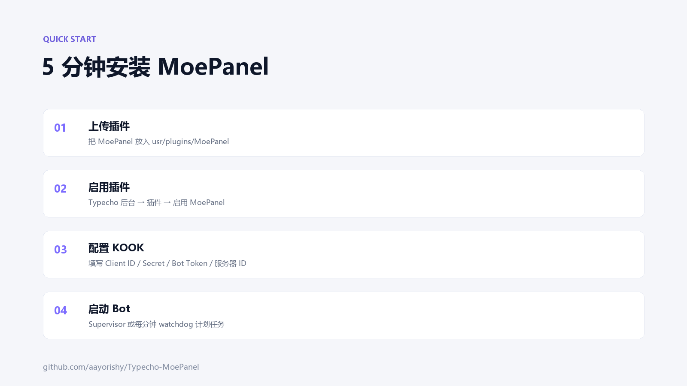

# MoePanel

> **Typecho × KOOK 一体化控制台 · 1.0.0 正式版**

[](https://github.com/aayorishy/Typecho-MoePanel/releases)
[](https://typecho.org)
[](https://www.php.net)
[](LICENSE)

MoePanel 是一套面向 Typecho 的设计师后台插件。它不修改 Typecho 核心，提供 Mac 风格的明暗双主题后台，并把 KOOK 登录、WebSocket 机器人、身份组领取、欢迎消息、DeepSeek 角色扮演和运行日志整合到同一个设置界面。



## 控制台

默认浅色主题，支持手动切换深色。侧边栏、侧边栏折叠、搜索、文章入口、KOOK 状态与统计卡片都在同一个工作区。



## 功能



### 后台体验

- Mac 风格明暗双主题
- 可折叠侧边栏、AJAX 导航、统一卡片组件
- 自定义主题色、LOGO、登录页标题
- 概览页、个人资料页、文章编辑器重构
- 自定义字段美化
- 评论管理同步 KOOK 头像与 `昵称#编号`
- 页面类型自定义字段自动列出当前主题独立页面

### KOOK 登录

- KOOK OAuth2 登录
- 昵称#编号 / 用户 ID + 六位验证码登录
- 管理员密码回退入口
- 登录后同步 KOOK 昵称
- 登录成功 CardMessage 私信
- 统一 `#FFCDCC` 卡片配色

### KOOK 机器人

- WebSocket 常驻 Bot
- 后台启用 / 停止 / 刷新
- 断线自动重连、指数退避、会话恢复
- 心跳超时检测
- PID 文件防重复启动
- 宝塔 Supervisor / 计划任务保活
- 机器状态汇总全部日志
- 在玩状态、邀请链接、频道目录

### 身份组领取

- CardMessage 身份组面板
- 每个身份组独立「领取 / 移除」按钮
- 正确读取按钮点击者
- 操作前检查是否已拥有
- 操作后重新验证身份组
- 失败原因私信反馈

### 欢迎消息

- 纯文字 KMarkdown 欢迎
- 支持 `{user}`、`{username}`、`{site}`、`{count}`
- `{count}` 使用 KOOK 服务器成员数量
- 不依赖 GD / FreeType / 图片生成
- 后台实时预览与测试发送

默认欢迎文字：

```text
欢迎 {user} 宝宝 ๑•́ㅅ•̀๑

( 欢迎小宝 )
( 玩的开心 )
```

### DeepSeek 角色扮演

- 只有 **@机器人** 才触发
- 普通 KMarkdown 文字回复，不使用卡片
- 每个服务器 / 用户独立上下文
- 支持重置上下文
- 后台测试 DeepSeek 连接
- 入口、跳过原因、错误全部写入日志

### 更新与日志

- GitHub Releases 检测
- 私有仓库 GitHub API Token
- 更新包 SHA-256 校验
- 机器状态查看：

```text
KOOK BOT / AI CHAT / EVENTS / WELCOME / ROLE CLAIM / POST PUSH
```

## 工作方式



```text
Typecho
  └─ MoePanel 后台 / 设置 / 事件
       ├─ KOOK OAuth / 验证码 / 登录同步
       ├─ WebSocket Bot
       │    ├─ 身份组领取
       │    ├─ 欢迎消息
       │    └─ @机器人 → DeepSeek
       └─ 机器状态 / 日志 / 更新
```

## 环境要求

| 项目 | 要求 |
|---|---|
| Typecho | 1.2+ |
| PHP | 8.1+ |
| 数据库 | MySQL / MariaDB / SQLite |
| PHP 扩展 | cURL、mbstring、ZipArchive |
| KOOK | 机器人 Token、服务器 ID |
| 可选 | Supervisor 或宝塔计划任务 |
| 不需要 | GD、FreeType、图片扩展 |

## 安装



### 1. 备份

```bash
cd /www/wwwroot/ayko-blog
cp -a usr/plugins/MoePanel usr/plugins/MoePanel.bak
```

### 2. 上传插件

将插件放入：

```text
usr/plugins/MoePanel
```

正确结构：

```text
usr/plugins/MoePanel/Plugin.php
usr/plugins/MoePanel/Panel.php
usr/plugins/MoePanel/Kook/
usr/plugins/MoePanel/assets/
usr/plugins/MoePanel/templates/
```

### 3. 启用插件

进入：

```text
Typecho 后台 → 插件 → MoePanel → 启用
```

### 4. 配置 KOOK

进入：

```text
设置 → 设置插件 MoePanel → 应用设置
```

填写：

```text
KOOK Client ID
KOOK Client Secret
Bot Token
服务器 ID
Owner KOOK ID
```

KOOK 开发者后台回调地址：

```text
https://你的域名/admin/login.php
```

### 5. 启动 Bot

手动启动一次：

```bash
cd /www/wwwroot/ayko-blog
php usr/plugins/MoePanel/kook-bot.php
```

后台也可以：

```text
KOOK → 机器状态 → 启用
```

## 宝塔自动保活

WebSocket 断线会自动重连；进程退出由保活任务拉起。

### 方案 A：Supervisor

```text
名称：moepanel-bot
运行目录：/www/wwwroot/ayko-blog
启动命令：/www/server/php/82/bin/php usr/plugins/MoePanel/kook-bot.php
进程数：1
自动启动：开启
自动重启：开启
```

PHP 路径按宝塔实际版本修改。

### 方案 B：宝塔计划任务

任务类型：

```text
Shell 脚本
```

执行周期：

```text
每 1 分钟
```

脚本内容：

```bash
#!/bin/bash

cd /www/wwwroot/ayko-blog || exit 1

# 已有 MoePanel Bot 时不重复启动
if pgrep -f '[M]oePanel/kook-bot.php' >/dev/null 2>&1; then
    exit 0
fi

# 自动寻找 PHP CLI，找不到就用宝塔常见路径
PHP_BIN="$(command -v php 2>/dev/null)"

if [ -z "$PHP_BIN" ]; then
    for candidate in /www/server/php/*/bin/php; do
        if [ -x "$candidate" ]; then
            PHP_BIN="$candidate"
            break
        fi
    done
fi

if [ -z "$PHP_BIN" ]; then
    echo "[$(date '+%F %T')] 找不到 PHP CLI" >> /tmp/moepanel-kook-bot/watchdog.log
    exit 1
fi

mkdir -p /tmp/moepanel-kook-bot

nohup "$PHP_BIN" usr/plugins/MoePanel/kook-bot.php \
    >> /tmp/moepanel-kook-bot/bot.log 2>&1 &

echo "[$(date '+%F %T')] 已启动 MoePanel Bot" >> /tmp/moepanel-kook-bot/watchdog.log
```

不要直接写：

```bash
php usr/plugins/MoePanel/kook-bot.php
```

Bot 是常驻进程，计划任务会一直等待或重复启动。

## 日志

| 日志 | 路径 |
|---|---|
| Bot | `/tmp/moepanel-kook-bot/bot.log` |
| 看门狗 | `/tmp/moepanel-kook-bot/watchdog.log` |
| AI | `/tmp/moepanel-ai-chat.log` |
| 事件 | `/tmp/moepanel-events.log` |
| 欢迎 | `/tmp/moepanel-welcome.log` |
| 身份组 | `/tmp/moepanel-role-claim.log` |
| 文章推送 | `/tmp/moepanel-kook-bot/post-push.log` |

也可以在：

```text
KOOK → 机器状态
```

直接查看汇总日志。

## 升级

1. 备份插件和数据库。
2. 覆盖插件目录。
3. 重新进入插件设置页。
4. 重启 Bot：

```bash
pkill -f 'kook-bot.php'
php usr/plugins/MoePanel/kook-bot.php
```

5. 机器状态刷新，确认只有一个进程。

## 目录结构

```text
MoePanel/
├── Plugin.php
├── Panel.php
├── Updater.php
├── kook-bot.php
├── github-webhook.php
├── bin/watchdog.sh
├── Kook/
│   ├── Auth.php
│   ├── Controller.php
│   ├── Settings.php
│   ├── KookClient.php
│   ├── BotDaemon.php
│   ├── BotRunner.php
│   ├── CardMessage.php
│   ├── RoleClaim.php
│   ├── Welcome.php
│   ├── AiChatService.php
│   ├── AiConversationStore.php
│   ├── DeepSeekClient.php
│   ├── PostNotifier.php
│   ├── Presence.php
│   └── WebSocketConnection.php
├── assets/
├── templates/
└── docs/images/
```

## 常见问题

### Bot 显示未运行但 KOOK 在线

```bash
ps -ef | grep -E 'kook-bot|MoePanel' | grep -v grep
```

如果有多个进程：

```bash
pkill -f 'kook-bot.php'
```

等待计划任务或 Supervisor 拉起。

### 欢迎消息不生效

```bash
tail -n 20 /tmp/moepanel-welcome.log
```

确认日志出现：

```text
发送文字欢迎
```

如果 KOOK 仍收到旧欢迎卡，检查 KOOK 原生欢迎消息或旧 Bot 进程。

### 身份组没有授予

机器人需要：

- 「管理角色」权限
- 身份组排序高于目标身份组
- 读取成员列表权限

```bash
tail -n 20 /tmp/moepanel-role-claim.log
```

### 角色扮演不回复

角色扮演只响应：

```text
@机器人
```

普通聊天、@其他用户不会触发。

```bash
tail -n 20 /tmp/moepanel-ai-chat.log
```

## 1.0.0 更新内容

- 全新 Mac 风格后台与明暗主题
- KOOK OAuth、验证码、密码回退登录
- WebSocket Bot 自动重连、会话恢复、心跳检测
- 机器状态启用 / 停止 / 刷新与全部日志
- 身份组领取、拥有检查、操作验证与私信反馈
- 纯文字欢迎，`{count}` 使用服务器成员数
- DeepSeek 角色扮演改为仅 @机器人触发
- 自定义字段美化与主题页面选择
- 评论管理同步 KOOK 头像与昵称#编号
- 修复升级后设置页无法打开
- 私有仓库更新检测支持 GitHub API Token

## 链接

- 仓库：<https://github.com/aayorishy/Typecho-MoePanel>
- Releases：<https://github.com/aayorishy/Typecho-MoePanel/releases>
- Issues：<https://github.com/aayorishy/Typecho-MoePanel/issues>
- 作者：<https://github.com/aayorishy>

## License

MIT
